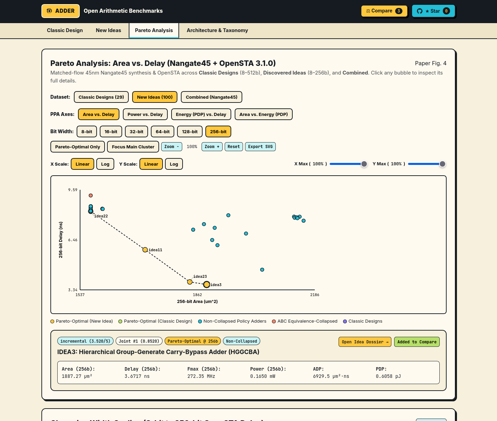
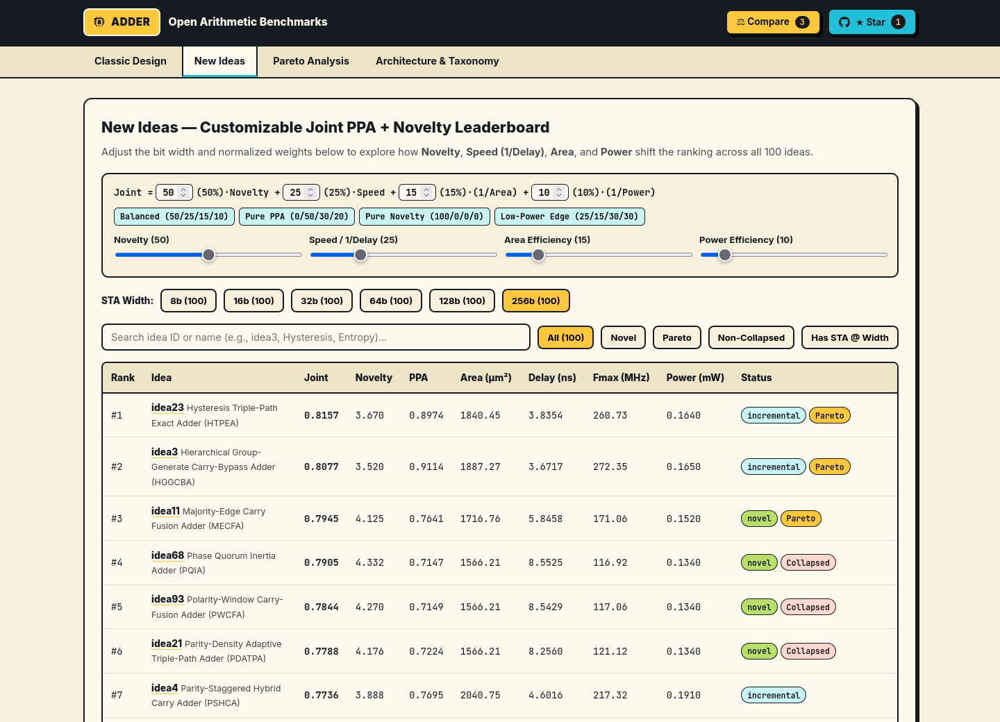
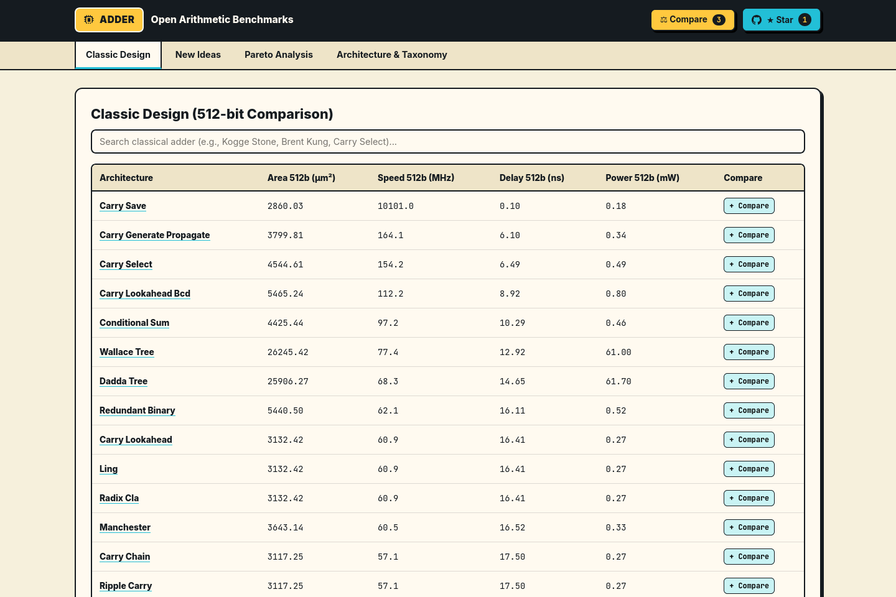
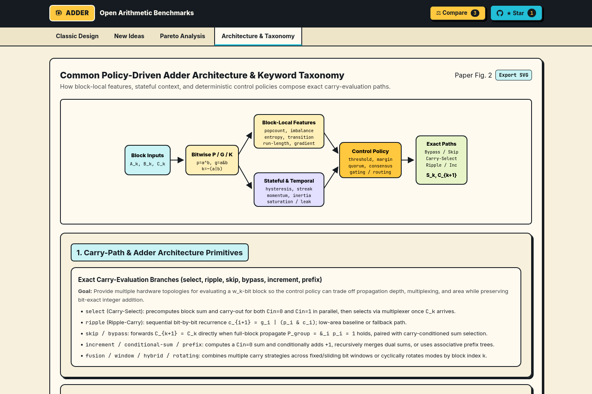
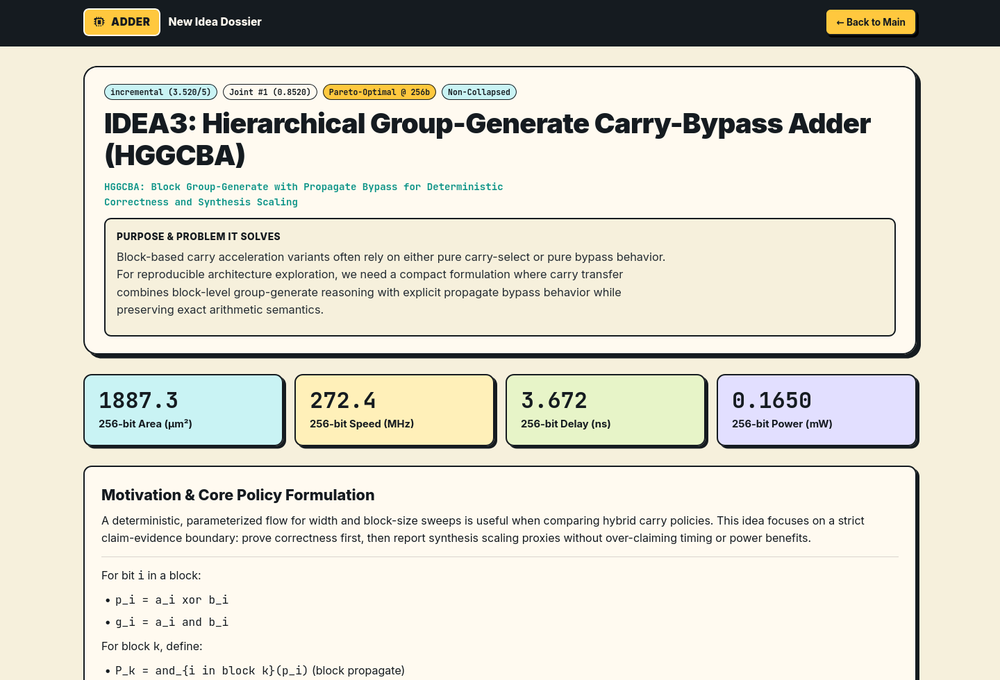

# ADDER — Open Arithmetic Benchmark & 100-Idea Discovery Website

[](https://sjtu-yongfu-research-grp.github.io/adder-website/)
[](https://creativecommons.org/licenses/by/4.0/)
[](#dataset-structure-and-schema)
[](https://github.com/SJTU-YONGFU-RESEARCH-GRP/adder-website/stargazers)
[](https://github.com/SJTU-YONGFU-RESEARCH-GRP/adder-website/commits/main)

**ADDER** (`adder-website`) is the interactive open-science benchmark explorer and architecture discovery portal from [SJTU-YONGFU-RESEARCH-GRP](https://github.com/SJTU-YONGFU-RESEARCH-GRP). It pairs a standardized 45 nm Nangate45 + OpenSTA 3.1.0 characterization dataset ([`data.json`](data.json)) with a zero-build static web application covering **29 classical digital adder architectures** (`8–512` bits) and **100 policy-driven exact adder proposals** (`idea1`–`idea100`, `8–256` bits).

- **Live website**: https://sjtu-yongfu-research-grp.github.io/adder-website/
- **Website repository**: https://github.com/SJTU-YONGFU-RESEARCH-GRP/adder-website
- **Umbrella lab**: https://github.com/SJTU-YONGFU-RESEARCH-GRP/adder-lab
- **Baseline RTL catalog**: https://github.com/SJTU-YONGFU-RESEARCH-GRP/core-adder
- **100-idea playground**: https://github.com/SJTU-YONGFU-RESEARCH-GRP/idea-adders
- **Benchmark dataset**: [`data.json`](data.json)
- **License**: CC BY 4.0 (see [`LICENSE`](LICENSE))

> [!TIP]
> **Like our website? Give it a ★ Star for more updates!**
> If you find this benchmark explorer useful for computer arithmetic, RTL synthesis, or EDA research, please click **`★ Star`** in the [live website header](https://sjtu-yongfu-research-grp.github.io/adder-website/) or **Star & Watch** this [GitHub repository](https://github.com/SJTU-YONGFU-RESEARCH-GRP/adder-website). Your stars directly motivate and help prioritize upcoming releases — including wider bit-width sweeps, additional open PDKs, new exact/approximate adder families, and richer interactive dossiers!

## TL;DR

- **Synthesis & STA flow**: Matched-flow 45 nm Nangate45 (`Nangate45_typ.lib`) via Yosys/ABC + OpenSTA 3.1.0
- **Classic Designs**: **29** parameterized classical adders across 7 bit widths (`8`, `16`, `32`, `64`, `128`, `256`, `512` bits; 29/29 OpenSTA pass)
- **New Ideas**: **100** exact policy-driven adders (`idea1`–`idea100`) with **100/100** OpenSTA coverage across all 6 bit widths (`8`, `16`, `32`, `64`, `128`, `256` bits)
- **Novelty & equivalence collapse**: **10** ideas classified `novel`; **50/100** undergo Yosys/ABC equivalence collapse (`1566.21 µm²` at 256-bit)
- **256-bit New-Idea Pareto frontier**: `idea3` (HGGCBA), `idea23` (HTPEA), `idea11` (MECFA), and `idea22`
- **Featured champions**: `idea3` (pre-ranked Joint #1, `3.6717 ns` / `272.35 MHz` @ 256b), `idea11` (Joint #4, `novel`, `5.8458 ns` @ 256b), and `idea93` (Joint #6, `novel`, `8.5429 ns` / `1566.21 µm²` @ 256b)
- **Frontend stack**: Static HTML5, CSS3, and vanilla JavaScript (`index.html`, `design.html`, `idea.html`, `app.js`, `styles.css`, `.nojekyll`) deployed on GitHub Pages

## Table of contents

- [Website preview](#website-preview)
- [Interactive features](#interactive-features)
  - [Classic Design](#classic-design)
  - [New Ideas leaderboard](#new-ideas-leaderboard)
  - [Pareto Analysis](#pareto-analysis)
  - [Architecture and Taxonomy](#architecture-and-taxonomy)
  - [3-Way Compare Matrix](#3-way-compare-matrix)
- [Dataset structure and schema](#dataset-structure-and-schema)
  - [Verified dataset summary](#verified-dataset-summary)
  - [JSON schema](#json-schema)
- [Quick start (local preview)](#quick-start-local-preview)
- [Project layout](#project-layout)
- [Related repositories](#related-repositories)
- [Like, star, and stay updated](#like-star-and-stay-updated)
- [License](#license)
- [Contact](#contact)

## Website preview

Explore the live interactive dashboard at **[sjtu-yongfu-research-grp.github.io/adder-website](https://sjtu-yongfu-research-grp.github.io/adder-website/)**.

<p align="center">
  <a href="https://sjtu-yongfu-research-grp.github.io/adder-website/#benchmarking">
    
  </a>
</p>
<p align="center"><em>Pareto Analysis view comparing Area, Delay, Power, and Energy (PDP) frontiers across bit widths with clickable bubble dossiers and SVG export.</em></p>

<table>
  <tr>
    <th>New Ideas — Customizable Joint Leaderboard</th>
    <th>Classic Design — 512-bit Baseline Table</th>
  </tr>
  <tr>
    <td>
      <a href="https://sjtu-yongfu-research-grp.github.io/adder-website/#ideas">
        
      </a>
      <div align="center"><code>index.html#ideas</code></div>
    </td>
    <td>
      <a href="https://sjtu-yongfu-research-grp.github.io/adder-website/#database">
        
      </a>
      <div align="center"><code>index.html#database</code></div>
    </td>
  </tr>
  <tr>
    <th>Architecture &amp; Taxonomy</th>
    <th>Individual Idea Dossier (<code>idea3</code> HGGCBA)</th>
  </tr>
  <tr>
    <td>
      <a href="https://sjtu-yongfu-research-grp.github.io/adder-website/#taxonomy">
        
      </a>
      <div align="center"><code>index.html#taxonomy</code></div>
    </td>
    <td>
      <a href="https://sjtu-yongfu-research-grp.github.io/adder-website/idea.html?slug=idea3">
        
      </a>
      <div align="center"><code>idea.html?slug=idea3</code></div>
    </td>
  </tr>
</table>

## Interactive features

### Classic Design

The **Classic Design** tab ([`#database`](https://sjtu-yongfu-research-grp.github.io/adder-website/#database)) provides a searchable, sortable 512-bit comparison table across all **29** parameterized classical adder architectures from `core-adder` (`Bcd`, `Brent Kung`, `Brent Kung Hybrid`, `Carry Bypass`, `Carry Chain`, `Carry Completion Sensing`, `Carry Generate Propagate`, `Carry Lookahead`, `Carry Lookahead Bcd`, `Carry Save`, `Carry Select`, `Carry Skip`, `Conditional Sum`, `Dadda Tree`, `Error Correcting`, `Han Carlson`, `Knowles`, `Kogge Stone`, `Ladner Fischer`, `Ling`, `Lynch Swartzlander`, `Manchester`, `Radix Cla`, `Redundant Binary`, `Ripple Carry`, `Serial`, `Sparse Kogge Stone`, `Vedic`, and `Wallace Tree`). Clicking any architecture opens its dedicated dossier page (`design.html?slug=<slug>`) featuring a zoomable Mermaid datapath diagram with SVG download, 8-bit to 512-bit scaling plots and OpenSTA metrics table, complexity notes, and literature references.

### New Ideas leaderboard

The **New Ideas** tab ([`#ideas`](https://sjtu-yongfu-research-grp.github.io/adder-website/#ideas)) ranks all **100** policy-driven exact adders (`idea1`–`idea100`) using a live-editable Joint PPA + Novelty score:

$$\text{Joint} = w_{\text{nov}} \cdot \frac{\text{Novelty}}{5} + w_{\text{delay}} \cdot \frac{\min(D)}{D} + w_{\text{area}} \cdot \frac{\min(A)}{A} + w_{\text{power}} \cdot \frac{\min(P)}{P}$$

Users can adjust weights directly via inline numeric fields, range sliders, or one-click presets (**Balanced** `50/25/15/10`, **Pure PPA** `0/50/30/20`, **Pure Novelty** `100/0/0/0`, **Low-Power Edge** `25/15/30/30`), switch STA bit widths (`8b`–`256b`, all with `100/100` coverage), filter by `All (100)`, `Novel`, `Pareto`, `Non-Collapsed`, or `Has STA @ Width`, inspect the **Joint Preset Sensitivity & Rank Trajectories** SVG chart (with `Export SVG`), and click into per-idea dossiers (`idea.html?slug=idea3`) with mathematical policy formulations and width-scaling curves.

### Pareto Analysis

The **Pareto Analysis** tab ([`#benchmarking`](https://sjtu-yongfu-research-grp.github.io/adder-website/#benchmarking)) plots physical PPA trade-offs across **Classic Designs (29)**, **New Ideas (100)**, or **Combined (Nangate45)**. Controls include four axis pairs (**Area vs. Delay**, **Power vs. Delay**, **Energy (PDP) vs. Delay**, **Area vs. Energy (PDP)**), bit widths (`8-bit` to `256-bit`, plus `512-bit` for Classic Designs), `Pareto-Optimal Only` and `Focus Main Cluster` filters, Linear/Log axis toggles, X/Y Max range sliders, zoom controls, clickable bubble inspection cards, `Export SVG`, and a **Champion Width Scaling** chart comparing `idea3` (HGGCBA), `idea11` (MECFA), and `idea93` (PWCFA) from 8-bit to 256-bit. Note that `db_carry_save` (3:2 redundant carry-save compressor) is excluded from carry-propagating adder (CPA) Pareto frontier calculations.

### Architecture and Taxonomy

The **Architecture & Taxonomy** tab ([`#taxonomy`](https://sjtu-yongfu-research-grp.github.io/adder-website/#taxonomy)) presents a vector diagram of the common policy-driven adder pipeline (bitwise `P/G/K` generation, block-local statistical features, stateful/temporal context signals, deterministic control policy, and exact carry-evaluation paths) with `Export SVG`, alongside structured mathematical definitions across four taxonomy pillars and Yosys/ABC synthesis equivalence collapse notes.

### 3-Way Compare Matrix

Clicking **Compare** in the header (or pressing **`C`** on the keyboard) opens a side-by-side matrix comparing any three classical or discovered architectures across source kind, Joint rank/score, novelty score, area, delay, $F_{\max}$, power, and Pareto/collapse status, with presets for **Top Champions**, **Pareto Top-3**, and **Classical Prefix**.

## Dataset structure and schema

### Verified dataset summary

All website views are backed by [`data.json`](data.json), verified directly against its top-level keys (`classical`, `ideas`, `champions`, `keywords`):

| Collection | Entries | Bit widths covered | Key verified highlights |
| --- | --- | --- | --- |
| `classical` | 29 | `8`, `16`, `32`, `64`, `128`, `256`, `512` (29/29) | Standardized Nangate45 + OpenSTA baselines, Mermaid diagrams, references |
| `ideas` | 100 | `8`, `16`, `32`, `64`, `128`, `256` (100/100) | 10 `novel` ideas; 50 ABC-collapsed (`1566.21 µm²` @ 256b); 4 Pareto @ 256b |
| `champions` | 3 | `8`–`256` | `idea3` (`3.6717 ns`), `idea11` (`5.8458 ns`), `idea93` (`8.5429 ns`) @ 256b |
| `keywords` | 5 groups | Corpus-wide (`idea1`–`idea100`) | 6 terms per category across Carry-Path, Control, Stateful, Local, Verification |

### JSON schema

**Classical entry (`data.json` → `classical[]`)**:

```json
{
  "slug": "db_kogge_stone",
  "name": "Kogge Stone",
  "kind": "classical",
  "area_512": 10528.28,
  "freq_512_mhz": 50.23,
  "delay_512_ns": 19.9066,
  "power_512_mw": 0.885,
  "scaling": [
    { "width": 8, "area": 70.49, "delay": 0.4817, "freq": 2075.98, "power": 0.0062, "cells": -1 },
    { "width": 512, "area": 10528.28, "delay": 19.9066, "freq": 50.23, "power": 0.885, "cells": -1 }
  ]
}
```

**Discovered idea entry (`data.json` → `ideas[]`)**:

```json
{
  "slug": "idea3",
  "idea_id": 3,
  "name": "Hierarchical Group-Generate Carry-Bypass Adder (HGGCBA)",
  "joint_rank": 1,
  "joint_score": 0.852,
  "nov_score": 3.52,
  "ppa_score": 1.0,
  "decision": "incremental",
  "pareto_256": true,
  "collapsed_cla": false,
  "area_256": 1887.27,
  "delay_256_ns": 3.6717,
  "fmax_256_mhz": 272.35,
  "power_256_mw": 0.165,
  "sta_scaling": [
    { "width": 256, "area": 1887.27, "delay": 3.6717, "fmax": 272.35, "power": 0.165 }
  ]
}
```

## Quick start (local preview)

Because [`app.js`](app.js), [`design.html`](design.html), and [`idea.html`](idea.html) load [`data.json`](data.json) using the browser `fetch()` API, serve the repository over a local HTTP server rather than opening HTML files with `file://`:

```bash
git clone https://github.com/SJTU-YONGFU-RESEARCH-GRP/adder-website.git
cd adder-website
python3 -m http.server 8000
```

Then open `http://localhost:8000` in your browser. External runtime dependencies are limited to browser-loaded CDN fonts (`Inter`, `JetBrains Mono`) and `mermaid@10` on `design.html`, plus an optional live GitHub API star-count lookup.

## Project layout

```text
adder-website/
├── .nojekyll                      # Disables Jekyll processing on GitHub Pages
├── LICENSE                        # CC BY 4.0 license deed
├── README.md                      # Project documentation and screenshots
├── index.html                     # Main 4-tab explorer and 3-way compare modal
├── design.html                    # Individual classic adder dossier and Mermaid diagram
├── idea.html                      # Individual new-idea dossier and policy equations
├── app.js                         # Interactive sorting, Joint scoring, Pareto/preset SVG charts
├── styles.css                     # Neo-brutalist theme and responsive layout
├── data.json                      # Verified Nangate45 + OpenSTA benchmark dataset
└── assets/                        # Website screenshots embedded in README.md
    ├── architecture-taxonomy.png
    ├── classic-design.png
    ├── idea-dossier.png
    ├── new-ideas.png
    └── pareto-analysis.png
```

## Related repositories

| Repository | Role |
| --- | --- |
| [adder-website](https://github.com/SJTU-YONGFU-RESEARCH-GRP/adder-website) | Interactive open-science benchmark and 100-idea discovery portal |
| [adder-lab](https://github.com/SJTU-YONGFU-RESEARCH-GRP/adder-lab) | Umbrella research orchestrator for digital binary adder design and benchmarking |
| [core-adder](https://github.com/SJTU-YONGFU-RESEARCH-GRP/core-adder) | Parameterized classical adder Verilog RTL library and verification |
| [adder-model](https://github.com/SJTU-YONGFU-RESEARCH-GRP/adder-model) | Behavioral Python / Verilog-A modeling |
| [adder_benchmarking](https://github.com/SJTU-YONGFU-RESEARCH-GRP/adder_benchmarking) | Multi-PDK PPA benchmarking and dashboard export |
| [idea-adders](https://github.com/SJTU-YONGFU-RESEARCH-GRP/idea-adders) | 100 exploratory policy-driven exact adder implementations |

## Like, star, and stay updated

We actively maintain **ADDER** as an open community resource for arithmetic hardware designers and EDA researchers. To support future updates and follow new releases:

1. **Star the website or repo**: Click **`★ Star`** in the top-right corner of **[sjtu-yongfu-research-grp.github.io/adder-website](https://sjtu-yongfu-research-grp.github.io/adder-website/)** or hit **Star** at the top of this GitHub page.
2. **Watch for updates**: Click **Watch → All Activity** (or **Releases / Custom**) on GitHub to receive alerts when new PDK benchmarks, RTL implementations, or interactive analysis tools land.
3. **Share feedback or contribute**: Open an [issue](https://github.com/SJTU-YONGFU-RESEARCH-GRP/adder-website/issues) to request new bit widths, adder topologies, export formats, or visualization features.

## License

This repository and its benchmark dataset are licensed under **Creative Commons Attribution 4.0 International (CC BY 4.0)**. See [`LICENSE`](LICENSE) and https://creativecommons.org/licenses/by/4.0/.

## Contact

- **Live Explorer**: https://sjtu-yongfu-research-grp.github.io/adder-website/
- **Issues & Feature Requests**: https://github.com/SJTU-YONGFU-RESEARCH-GRP/adder-website/issues
- **Organization**: https://github.com/SJTU-YONGFU-RESEARCH-GRP
